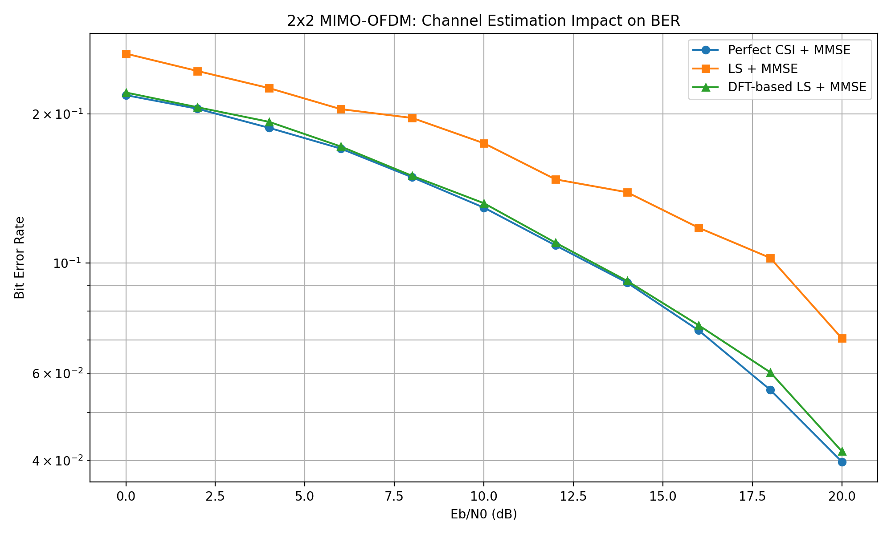
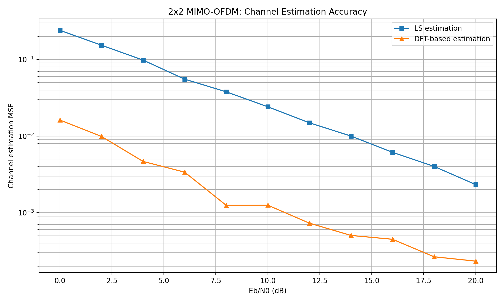

# Pilot-Assisted 2×2 MIMO-OFDM PHY Simulator

[](https://github.com/mohamedarawshi/mimo-ofdm-phy-simulator/actions/workflows/tests.yml)

A reproducible Python physical-layer simulation of a **2×2 spatial-multiplexing MIMO-OFDM** link. This educational project compares **perfect channel state information (CSI)**, **least-squares (LS) channel estimation**, and **DFT-denoised LS channel estimation** with **linear MMSE equalization**.

> **Scope:** 5G-style PHY concepts, **not** a 3GPP-compliant 5G NR modem. Uncoded, fixed, quasi-static frequency-selective channels; no mobility, coding, synchronization impairments, or standards-defined resource grids.

## Key results

The original integrated experiment uses 64 subcarriers, CP length 16, two orthogonal pilot OFDM symbols, 2000 QPSK data OFDM symbols, and a fixed four-tap **deliberately correlated** 2×2 MIMO channel. At 20 dB nominal data-bit Eb/N0:

| Receiver               |      BER |
| ---------------------- | -------: |
| Perfect CSI + MMSE     | 0.039777 |
| LS estimate + MMSE     | 0.070529 |
| DFT-denoised LS + MMSE | 0.041754 |

The DFT estimate achieves roughly **41% lower BER than raw LS** at this point. Its channel estimation MSE is approximately **16× lower** in this setup, consistent with projecting 64 frequency-domain estimates onto 4 supported delay taps. These are **scenario-specific simulation results**, not universal performance claims.





## Signal model

For each subcarrier k, the quasi-static frequency-domain channel is

```text
Y[k] = H[k] X[k] + W[k]
```

where H[k] is 2×2. A cyclic prefix of 16 samples exceeds the maximum channel delay of three samples, permitting per-subcarrier equalization in the ideal synchronized link.

Two pilot OFDM symbols use

```text
P = [[1,  1],
     [1, -1]]
```

with `P Pᴴ = 2I`. LS estimates `Ĥ[k] = Ypilot[k] Pᴴ / 2`. DFT denoising applies an IFFT to each estimated frequency response, retains the first **four** delay taps, and transforms back. This estimator **assumes known channel support/length**; it is not a general blind channel-length estimator.

MMSE estimates data as

```text
X̂[k] = (Ĥᴴ[k] Ĥ[k] + (N0/Es) I)⁻¹ Ĥᴴ[k] Y[k]
```

The experiment's `Eb/N0` uses `Es=1` and `Eb=Es/2` for QPSK **without accounting for CP and pilot overhead**. With NumPy's unnormalized FFT, time-domain complex AWGN variance is `N0/N` so FFT-domain variance is `N0`. This is a nominal, uncoded data-symbol SNR convention.

## Repository layout

```text
src/mimo_ofdm_phy/    Reusable QPSK, channel, estimation, equalization utilities
experiments/         Original learning experiments + integrated experiment runner
results/             Saved BER/MSE and channel estimation figures
tests/               Deterministic mathematical and end-to-end consistency checks
```

The original scripts are intentionally preserved in `experiments/` to retain reproducibility and the progression from AWGN/QPSK to MIMO-OFDM. The reusable package mirrors the main algorithms; **the original integrated experiment has not been rewritten to import the package**, minimizing the risk of changing previously reported results.

## Installation and verification

Requires Python 3.10+.

```bash
python3 -m venv .venv
source .venv/bin/activate
python -m pip install -e '.[dev]'
python -m pytest -q
```

Reproduce the main experiment and overwrite its two plots in `results/`:

```bash
MPLBACKEND=Agg python experiments/run_full.py
```

On a desktop you may omit `MPLBACKEND=Agg` to display interactive figures. To run other preserved experiments, execute them from the `results/` directory if you want their saved PNG files collected there.

## Other experiments

- `qpsk_awgn.py`, `ber_experiment.py`: QPSK in AWGN, BER vs theory.
- `ofdm_basic.py`, `ofdm_ber_experiment.py`: OFDM and cyclic prefix effects.
- `ofdm_pilots.py`, `pilot_ber_experiment.py`: pilot-aided SISO channel estimation.
- `mimo_zf_mmse.py`, `mmse_equalizer.py`: linear equalizers.
- `mimo_ofdm.py`: 2×2 MIMO-OFDM with ZF/MMSE and conditioning analysis.
- `mimo_channel_estimation.py`: orthogonal MIMO pilots and DFT denoising.
- `mimo_ofdm_full.py`: end-to-end integrated BER/MSE experiment.

## Limitations and interpretation

- A single fixed, highly correlated channel is used in the integrated BER experiment. The elevated perfect-CSI BER at 20 dB reflects challenging spatial conditioning; do not generalize to all MIMO channels.
- Channel length `L=4` is assumed known for DFT denoising.
- Perfect CSI is an oracle benchmark only; the practical LS and DFT receivers do not use true H for detection.
- Results are **uncoded BER**, not throughput, packet error rate, or 5G NR compliance measurements.
- Pilot overhead, CP overhead, fading ensembles, timing/frequency offsets, Doppler, and channel coding are not included in reported Eb/N0 normalization or system-level claims.

## License

MIT — see [LICENSE](LICENSE).
